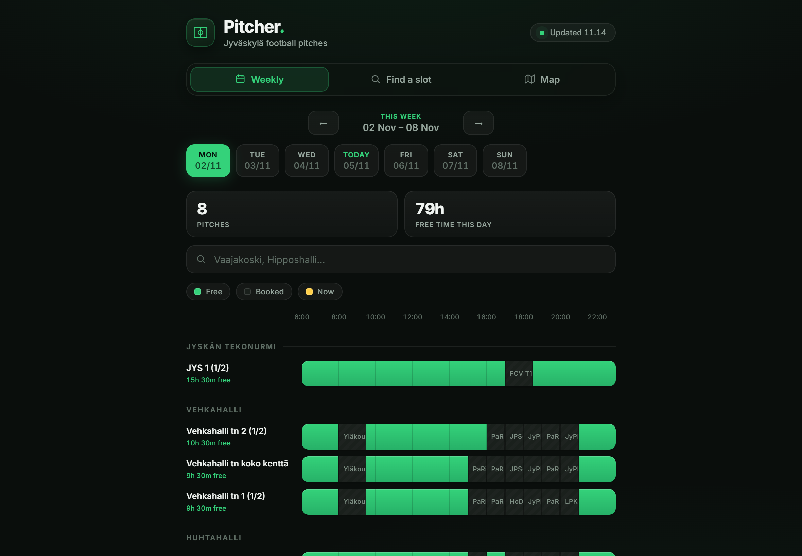
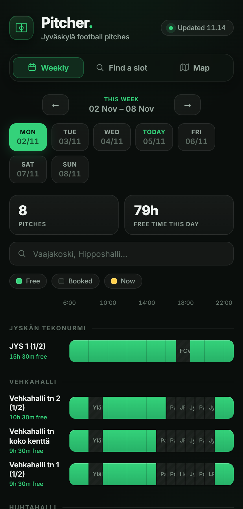
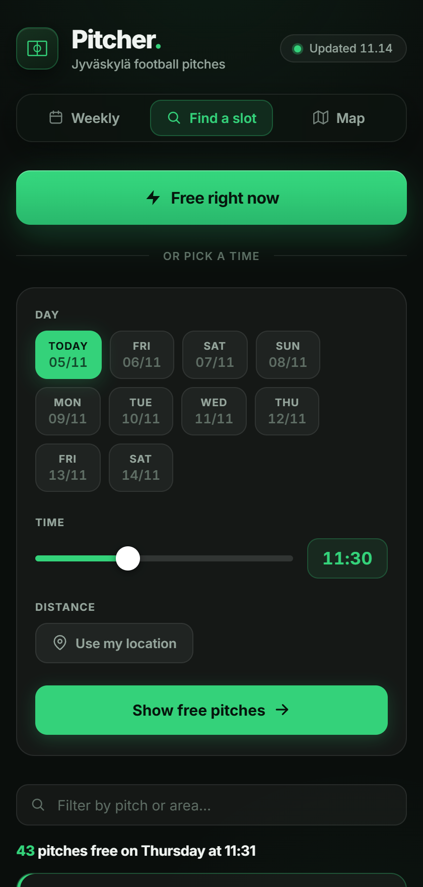
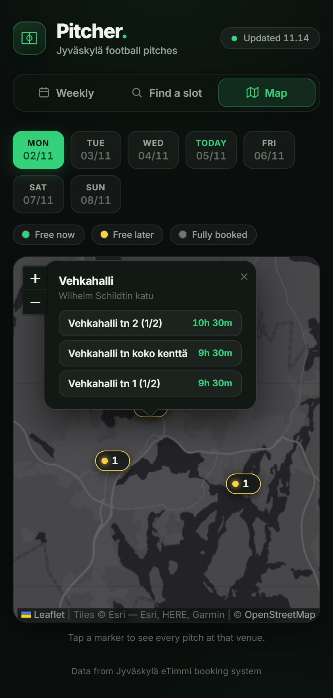
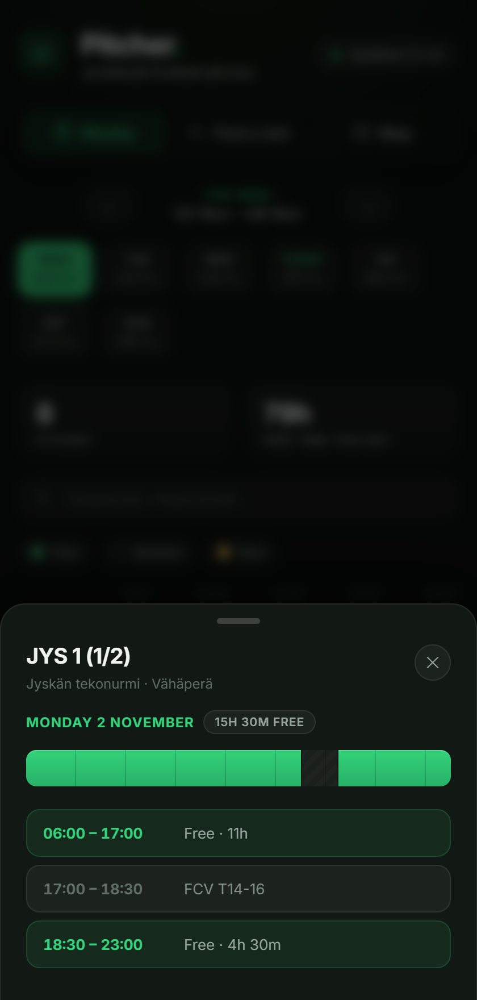

<div align="center">


# Pitcher

**Find a free football pitch in Jyväskylä — at a glance.**

Pitcher turns the city of Jyväskylä's public booking system into a fast, mobile‑first
dashboard that shows which outdoor football pitches are free, when, and how far away.

[](https://www.python.org/)
[](https://flask.palletsprojects.com/)
[](https://leafletjs.com/)
[](static/manifest.json)
[](https://github.com/JUSSI-G/pitcher/actions/workflows/ci.yml)
[](LICENSE)

**[🌐 Live demo →](https://pitcher-b322.onrender.com)**



</div>

---

## Why I built it

Booking a pitch in Jyväskylä means digging through the city's **eTimmi** system —
one pitch, one day at a time, in a dense calendar grid. I wanted a single screen that
answers the only question that actually matters when you want to play:

> *Where can I kick a ball right now (or on Thursday at 6pm), and how far is it?*

Pitcher scrapes every outdoor pitch, merges full‑field and half‑field bookings into one
honest availability picture, and presents it three ways: a **weekly timeline**, a
**slot finder**, and an **interactive map**.

## Features

- ⚡ **“Free right now”** — one tap shows every pitch open at this exact moment, nearest first.
- 📅 **Weekly timeline** — a colour‑coded bar per pitch across the whole playable day (06:00–23:00), grouped by venue, with a live “now” marker.
- 🔎 **Slot finder** — pick a day + time and get a ranked list of free pitches, sorted by distance when you share your location.
- 🗺️ **Map view** — every venue plotted with [Leaflet](https://leafletjs.com/); markers are colour‑coded by availability and open a popup of each pitch's free time.
- 🧠 **Smart merging** — a half‑pitch counts as booked when its parent full‑pitch is booked (and vice‑versa), so availability is never overstated.
- 📍 **Distance ranking** — Haversine distance from your location to each venue.
- 📱 **Installable PWA** — add to home screen, works full‑screen, dark‑first UI.
- ♿ **Thoughtful details** — keyboard‑dismissable sheets, reduced‑motion support, tabular numerics, skeleton loading.

## Screenshots

<div align="center">
<table>
  <tr>
    <td align="center"><b>Weekly board</b></td>
    <td align="center"><b>Find a slot</b></td>
    <td align="center"><b>Map</b></td>
  </tr>
  <tr>
    <td></td>
    <td></td>
    <td></td>
  </tr>
</table>



<sub>Tapping any pitch opens a full day schedule as a bottom sheet.</sub>
</div>

## How it works

The eTimmi server blocks cloud IP ranges, so live scraping only works from a personal
machine. Pitcher is built around that constraint with **two modes**:

| Mode | How data is served | Where it runs |
|------|--------------------|---------------|
| **Static** *(default)* | Serves a committed `static/bookings.json` snapshot | Anywhere, incl. Render |
| **Live** | Scrapes eTimmi on each request, 30‑min in‑process cache | A machine that can reach eTimmi |

```
                 scrape locally                serve
 eTimmi  ──────────────────────────▶  bookings.json  ──────────▶  Flask  ──▶  Browser
 (city booking API)   pitch_scraper.py        (snapshot)        app.py       (weekly / find / map)
                          └──────── both use etimmi.py ────────┘
```

### Design decisions

- **One eTimmi client.** `etimmi.py` owns the pitch list, venue coordinates, login, and
  episode parsing. The Flask app and the scraper are thin wrappers around it.
- **Helsinki time everywhere.** Week boundaries are computed with `zoneinfo` in
  `Europe/Helsinki` on the server and with `Intl.DateTimeFormat` in the browser, so a UTC
  host (like Render) and a viewer abroad both see the right Monday and the right hours.
- **Filler removal.** eTimmi pads closed hours with unlabeled blocks touching midnight;
  these are dropped so they don't show up as bookings.
- **Half/full pitch merging.** A half‑pitch is shown booked when its full pitch is booked,
  and vice‑versa, so availability is never overstated.
- **Safe rendering.** Booking labels are user‑entered upstream, so every value is
  HTML‑escaped before it reaches the DOM.
- **Resilient live mode.** Upstream failures return a clean `502` JSON error instead of a
  stack trace; responses are cached for 30 minutes per week.
- **Dependency‑light frontend.** Vanilla JavaScript for all logic, Leaflet only for the map.

## Tech stack

- **Backend:** Python 3.12, [Flask](https://flask.palletsprojects.com/), [Requests](https://requests.readthedocs.io/), served with [Gunicorn](https://gunicorn.org/)
- **Frontend:** Vanilla JS, CSS custom properties, [Leaflet](https://leafletjs.com/) + Esri/OpenStreetMap tiles, [Inter](https://rsms.me/inter/)
- **PWA:** Web app manifest + maskable SVG icon
- **Quality:** [pytest](https://pytest.org/) (17 tests), [Ruff](https://docs.astral.sh/ruff/), GitHub Actions CI
- **Deploy:** [Render](https://render.com/) (`render.yaml`, free tier, `/healthz` health check)

## Getting started

```bash
git clone https://github.com/JUSSI-G/pitcher.git
cd pitcher

python -m venv venv
source venv/bin/activate        # Windows: venv\Scripts\activate
pip install -r requirements.txt  # or requirements-dev.txt to run the tests

python app.py                   # serves the committed snapshot at http://127.0.0.1:5000
```

### Live scraping (local only)

Run the app against real‑time eTimmi data:

```bash
PITCHER_LIVE=true python app.py            # macOS / Linux
set PITCHER_LIVE=true && python app.py     # Windows (cmd)
```

### Refreshing the snapshot

The scraper walks every pitch for this week and next, then writes the snapshot:

```bash
python pitch_scraper.py
git add static/bookings.json
git commit -m "update bookings"
git push                        # Render redeploys automatically (~1 min)
```

## Testing

```bash
pip install -r requirements-dev.txt
pytest          # unit + API tests, no network needed
ruff check .    # lint
```

The tests cover label parsing, filler detection, Helsinki week boundaries (including a UTC
server clock), episode de‑duplication, the static and live API paths, week clamping,
caching, and upstream‑failure handling. eTimmi is never called; sessions are faked.

## API

| Endpoint | Description |
|----------|-------------|
| `GET /api/bookings?week=N` | Pitches + bookings for week offset `N` (−1 … 4, clamped) |
| `GET /healthz` | `{"ok": true, "mode": "static"}` (or `"live"`) |

## Deployment

Pitcher deploys to Render from `render.yaml` with zero extra config. The free tier spins
down after inactivity, so the first request after a sleep triggers a ~30 s cold start.
Because production runs in **static mode**, you refresh live data simply by committing a
fresh `static/bookings.json`.

## Project structure

```
pitcher/
├── etimmi.py              # eTimmi client: login, pitches, parsing (shared)
├── app.py                 # Flask app — static & live modes, /api/bookings
├── pitch_scraper.py       # CLI: scrape → static/bookings.json
├── templates/
│   └── index.html         # App shell (tabs, views, Leaflet include)
├── static/
│   ├── app.js             # All frontend logic & rendering
│   ├── style.css          # Dark-first design system
│   ├── bookings.json      # Committed data snapshot
│   ├── icon.svg           # Maskable PWA icon
│   └── manifest.json      # PWA manifest
├── tests/                 # pytest suite (no network)
├── docs/                  # README screenshots
├── .github/workflows/     # CI: lint + tests
├── pyproject.toml         # Project metadata, pytest & ruff config
├── render.yaml            # Render deploy config
├── runtime.txt            # Python version pin
├── requirements.txt       # Pinned runtime deps
└── requirements-dev.txt   # + pytest, ruff
```

## Notes & limitations

- Availability reflects the **last snapshot**; the “Updated HH:MM” chip shows when.
- Only the playable window **06:00–23:00** is rendered.
- Venue coordinates are a hand‑maintained lookup in `app.py` / `pitch_scraper.py`.
- Data belongs to the City of Jyväskylä; this project only visualises their public eTimmi feed.

## License

[MIT](LICENSE) © JUSSI-G
