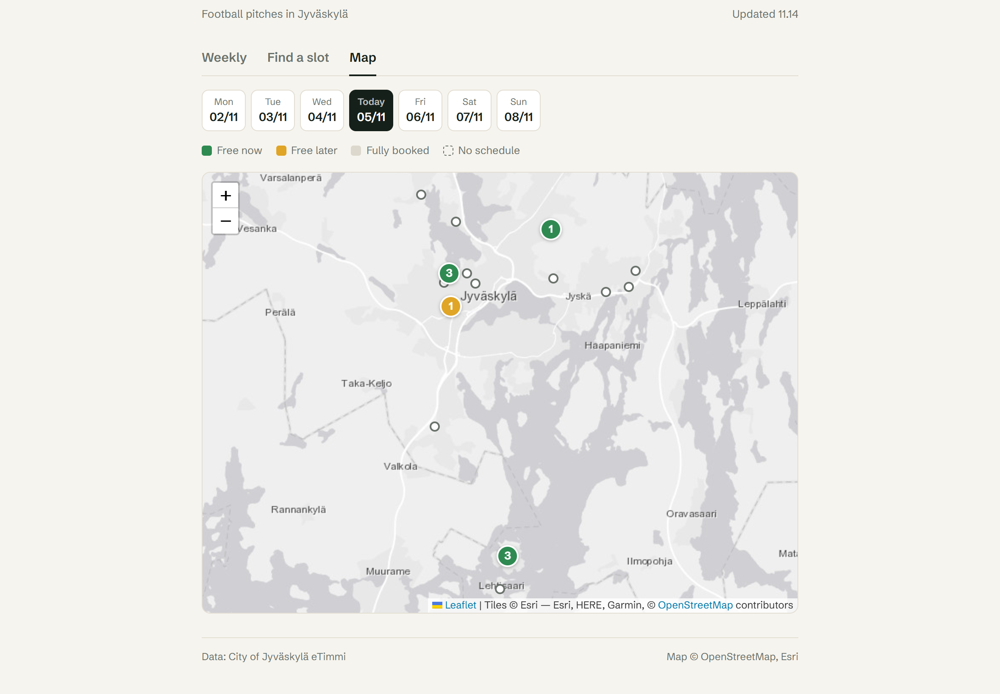

<p align="center">
  
</p>

<p align="center">
  Live availability for every football pitch in Jyväskylä, Finland,<br>
  built on top of the city's public eTimmi booking system.
</p>

<p align="center">
  <a href="https://github.com/JUSSI-G/pitcher/actions/workflows/ci.yml"></a>
  
  
  
  <a href="LICENSE"></a>
</p>

<p align="center">
  <a href="https://pitcher-b322.onrender.com"><b>Live demo</b></a> &nbsp;·&nbsp;
  <a href="#getting-started">Run locally</a> &nbsp;·&nbsp;
  <a href="#how-it-works">How it works</a>
</p>

<p align="center">
  
</p>

## Overview

Booking a pitch in Jyväskylä means clicking through the city's eTimmi calendar one pitch
and one day at a time. Pitcher collects every pitch into a single view and answers the one
question that matters when you want to play: **where is a pitch free right now, or at the
time I want, and how far away is it?**

It scrapes all 46 bookable pitch areas across 21 venues, combines full-pitch and half-pitch
bookings into one picture, and shows it as a weekly timeline, a slot finder and a map.

## Highlights

- **Weekly board.** One timeline per pitch across the playable day (06:00–23:00), grouped
  by venue, with a live "now" marker. Tap any pitch to see its full schedule for the day.
- **Find a slot.** "Free right now" in one tap, or pick a day and time to get a ranked list
  of free pitches, sorted by distance if you share your location.
- **Map.** All 21 venues plotted with Leaflet. Each marker shows how many pitches are free
  and opens a list of that venue's pitches.
- **Accurate availability.** A half pitch counts as booked when its full pitch is, and the
  other way round. Pitches with no published schedule are shown as unknown, not as free.
- **Correct across timezones.** Week boundaries are calculated in Helsinki time on the
  server and in the browser, so a UTC host and a visitor abroad see the same week.
- **Tested.** 18 pytest tests, linting with Ruff, and GitHub Actions CI on every push.

## Screenshots

<table>
  <tr>
    <th>Weekly board</th>
    <th>Find a slot</th>
    <th>Map</th>
  </tr>
  <tr>
    <td></td>
    <td></td>
    <td></td>
  </tr>
</table>

<table>
  <tr>
    <th>Pitch schedule</th>
    <th>Map on desktop</th>
  </tr>
  <tr>
    <td></td>
    <td></td>
  </tr>
</table>

## How it works

```
                 scrape locally                serve
 eTimmi  ──────────────────────────▶  bookings.json  ──────────▶  Flask  ──▶  Browser
 (city booking API)   pitch_scraper.py        (snapshot)        app.py       (weekly / find / map)
                          └──────── both use etimmi.py ────────┘
```

eTimmi blocks requests from cloud IP ranges, so the hosted app can't scrape it directly.
Pitcher handles that with two modes:

| Mode | Where the data comes from | Where it runs |
|------|---------------------------|---------------|
| **Static** (default) | A `static/bookings.json` snapshot committed to the repo | Anywhere, including Render |
| **Live** | eTimmi, scraped on request with a 30-minute cache | Any machine that can reach eTimmi |

The scraper runs on a personal machine, the snapshot is committed, and Render redeploys
automatically.

## Engineering notes

- **One eTimmi client.** `etimmi.py` owns the pitch list, venue coordinates, login and
  parsing. The Flask app and the scraper are thin wrappers around it.
- **Timezone bug fixed.** The server originally calculated "this week" in its own local
  time. On Render that is UTC, so the week could flip at the wrong moment on Sunday nights.
  Week boundaries now use `zoneinfo` with `Europe/Helsinki`, and a test covers the case.
- **No schedule is not the same as free.** eTimmi returns nothing at all for pitches
  without a published schedule, typically outdoor pitches out of season. These are left
  out of counts and search results instead of being reported as open all day.
- **Padding removed.** eTimmi fills closed hours with unlabeled blocks that touch midnight.
  These are filtered out so they don't appear as bookings.
- **Geocoded venues.** Venue coordinates were checked against OpenStreetMap. Several of the
  original hand-entered ones were 2–5 km off. They are applied when the data is served, so
  a fix doesn't need a new scrape.
- **Safe rendering.** Booking names are typed in by eTimmi users, so every value is
  HTML-escaped before it is inserted into the page.
- **Clean failures.** If eTimmi is unreachable in live mode, the API returns a `502` JSON
  error instead of a stack trace. A `/healthz` endpoint is used by Render's health check.
- **Small frontend.** Plain JavaScript and CSS with no build step. The only library is
  Leaflet, for the map.

## Tech stack

| Layer | Tools |
|-------|-------|
| Backend | Python 3.12, Flask, Requests, Gunicorn |
| Frontend | JavaScript, CSS, Leaflet, Esri and OpenStreetMap map tiles |
| Fonts | Big Shoulders Display (wordmark), Schibsted Grotesk (text) |
| Quality | pytest, Ruff, GitHub Actions |
| Hosting | Render, installable as a PWA |

## Getting started

```bash
git clone https://github.com/JUSSI-G/pitcher.git
cd pitcher

python -m venv venv
source venv/bin/activate          # Windows: venv\Scripts\activate
pip install -r requirements.txt

python app.py                     # http://127.0.0.1:5000, using the committed snapshot
```

To scrape eTimmi live instead (needs a network that can reach eTimmi):

```bash
PITCHER_LIVE=true python app.py            # macOS / Linux
set PITCHER_LIVE=true && python app.py     # Windows (cmd)
```

To refresh the snapshot for the hosted version:

```bash
python pitch_scraper.py           # scrapes this week and next
git add static/bookings.json
git commit -m "update bookings"
git push                          # Render redeploys automatically
```

## Testing

```bash
pip install -r requirements-dev.txt
pytest
ruff check .
```

The tests cover label parsing, padding detection, Helsinki week boundaries (including a
server running in UTC), duplicate removal, coordinate replacement, the static and live API
paths, caching and upstream failures. eTimmi is never contacted during tests.

## API

| Endpoint | Description |
|----------|-------------|
| `GET /api/bookings?week=N` | Pitches and bookings for week offset `N` (−1 to 4) |
| `GET /healthz` | `{"ok": true, "mode": "static"}` or `"live"` |

## Project structure

```
pitcher/
├── etimmi.py              # eTimmi client: login, pitches, parsing, venue coordinates
├── app.py                 # Flask app and API
├── pitch_scraper.py       # Command-line scraper that writes the snapshot
├── templates/index.html   # Page markup
├── static/
│   ├── app.js             # Frontend logic and rendering
│   ├── style.css          # Styles
│   ├── bookings.json      # Data snapshot
│   ├── icon.svg           # App icon
│   └── manifest.json      # PWA manifest
├── tests/                 # pytest suite
├── docs/                  # README images
├── .github/workflows/     # CI
├── pyproject.toml         # pytest and Ruff configuration
├── render.yaml            # Render deployment
├── requirements.txt       # Pinned runtime dependencies
└── requirements-dev.txt   # Test and lint dependencies
```

## Limitations

- Data is only as fresh as the last snapshot. The page header shows when it was taken.
- Outdoor pitches usually have no published schedule outside the season, so in winter only
  the halls and a few artificial-turf pitches appear on the board.
- A few venues are placed at the neighbouring school or area rather than the pitch itself.
  These are marked with `~` in `etimmi.py`.

## Possible next steps

- Refresh the snapshot automatically from a self-hosted runner that can reach eTimmi.
- Let users save favourite venues and get notified when a usual time slot frees up.
- Add a Finnish language option.

## Credits

Booking data belongs to the City of Jyväskylä and comes from its public eTimmi system.
Map data © OpenStreetMap contributors, map tiles © Esri.

## License

[MIT](LICENSE) © JUSSI-G
